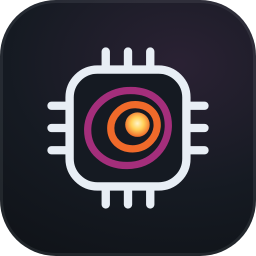

<p align="center">
  
</p>

<h1 align="center">Nebula</h1>

<p align="center">
  Hardware-Monitor für Windows: Temperaturen, Auslastung, Prozesse und alle Bauteile deines PCs auf einen Blick.
</p>

<p align="center">
  <a href="../../releases/latest"><strong>⬇ Nebula für Windows herunterladen</strong></a>
</p>

---

## Installieren

1. Unter [Releases](../../releases/latest) die Datei **`Nebula-Setup-x.x.x.exe`** herunterladen
2. Doppelklick, die Windows-Abfrage mit **Ja** bestätigen und den Schritten folgen
3. Fertig: Nebula liegt auf dem Desktop und im Startmenü, **CPU- und GPU-Temperaturen funktionieren sofort**

Updates kommen automatisch: Nebula prüft beim Start, ob es eine neue Version gibt, und installiert sie beim nächsten Beenden.

> **„Der Computer wurde durch Windows geschützt“?**
> Windows warnt bei neuen Programmen ohne kostenpflichtige Signatur. Klicke auf **Weitere Informationen → Trotzdem ausführen**.

Lieber ohne Installation? Dann nimm **`Nebula-Portable-x.x.x.exe`** (ohne automatische Updates).

## Was Nebula zeigt

- **Übersicht**: CPU, GPU, Arbeitsspeicher und Systemlaufwerk auf einen Blick, mit Temperaturen
- **Detailseiten per Klick**: z. B. beim Prozessor jeder Kern mit Takt, Last und Temperatur, große Verlaufsdiagramme, Leistung in Watt
- **Hardware**: Prozessor, Grafikkarte, jeder RAM-Riegel, Mainboard, BIOS, Bildschirme, SSDs/HDDs mit SMART-Zustand, Netzwerkkarten
- **Sensoren**: alle Temperaturen, Lüfterdrehzahlen, Takte und Leistungswerte
- **Prozesse**: Apps und Hintergrundprozesse getrennt, Suche, Sortierung, aufklappbare Einzelprozesse und **Task beenden** (wichtige Windows-Prozesse sind geschützt)
- **Systembericht** zum Kopieren oder Speichern, praktisch für Foren und Support
- Wärmebild-Design mit vier Paletten, Tray-Icon, Autostart, Tastenkürzel `Strg + Shift + N`

## Temperaturen: was der Installer mitinstalliert

Windows gibt CPU-Temperaturen nur an Programme mit eigenem Treiber heraus. Deshalb richtet der Installer automatisch mit ein:

- **[PawnIO](https://pawnio.eu)**: ein signierter Treiber zum Auslesen der Sensoren
- **[LibreHardwareMonitor](https://github.com/LibreHardwareMonitor/LibreHardwareMonitor)**: liest alle Temperaturen, Lüfter und Leistungswerte
- Eine geplante Windows-Aufgabe **„Nebula Sensoren“**, die LibreHardwareMonitor beim Hochfahren unsichtbar startet

Die Sensordaten sind nur auf deinem eigenen PC erreichbar (`127.0.0.1:8085`) und werden nirgendwohin gesendet.
Beim Deinstallieren von Nebula werden Aufgabe und Sensor-Dienst wieder entfernt. PawnIO bleibt installiert, weil auch andere Programme den Treiber nutzen können. Er lässt sich bei Bedarf unter **Windows-Einstellungen → Apps** entfernen.

Die portable Version kann den Sensor-Dienst unter **Sensoren → Sensoren einrichten** nachträglich aktivieren.

## Selbst bauen

```
npm install
npm start          # Entwicklungsmodus
npm run sensors    # Sensor-Dienst zum Einpacken laden (Windows)
npm run dist       # EXE lokal bauen (Ordner dist/)
```

Releases baut GitHub automatisch: **Actions → Nebula veröffentlichen → Run workflow**.

## Lizenzen

- Nebula: MIT
- [systeminformation](https://github.com/sebhildebrandt/systeminformation): MIT
- [LibreHardwareMonitor](https://github.com/LibreHardwareMonitor/LibreHardwareMonitor): MPL-2.0, unverändert mitgeliefert
- [PawnIO](https://github.com/namazso/PawnIO): GPL-2.0, offizieller Installer unverändert mitgeliefert, Quellcode unter dem Link
- Schrift [Chakra Petch](https://fonts.google.com/specimen/Chakra+Petch): SIL Open Font License 1.1
